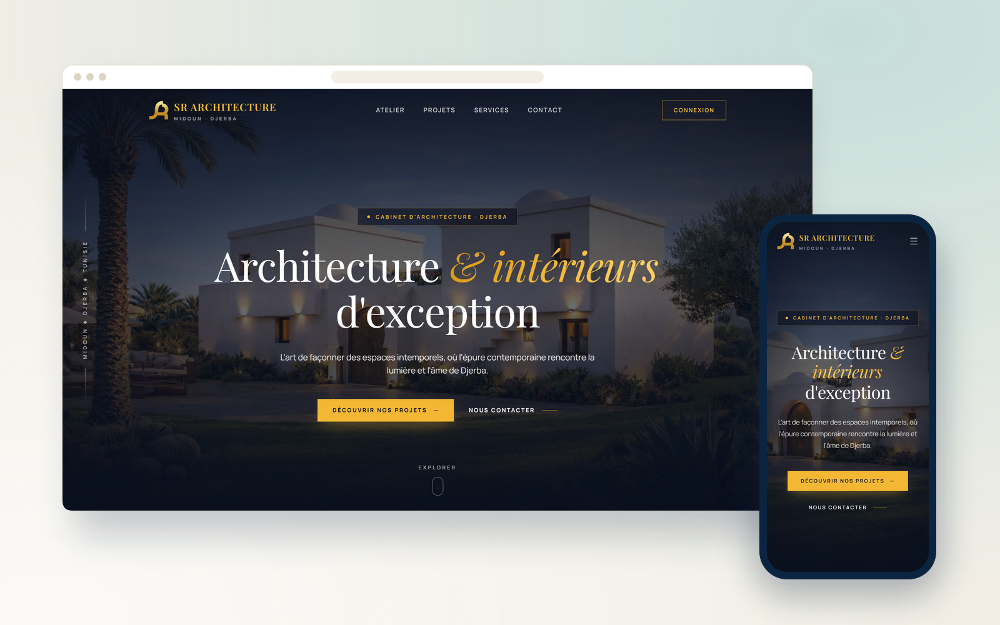
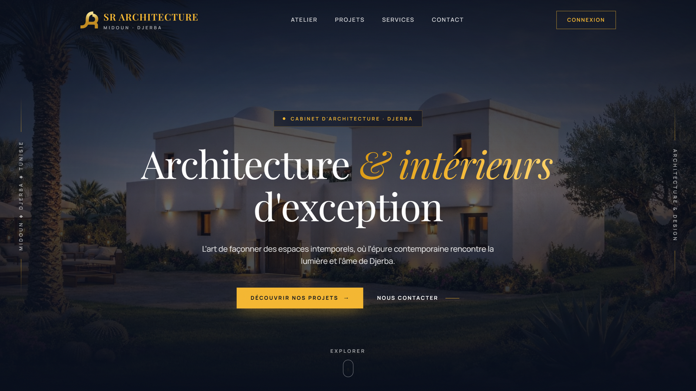
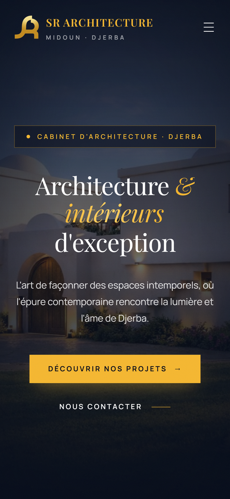
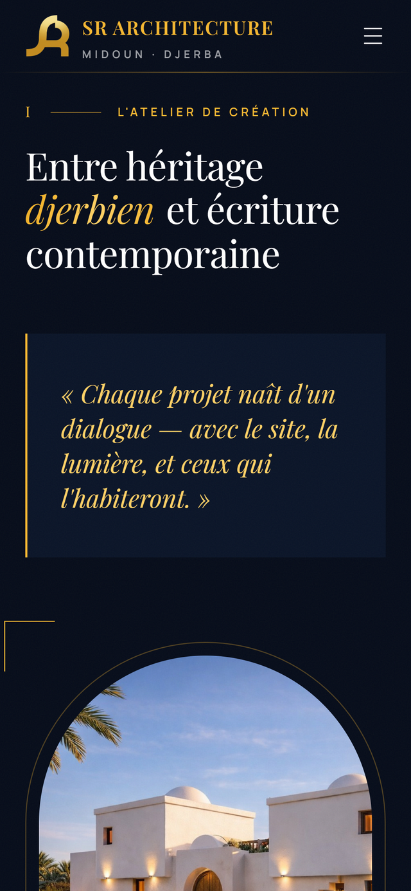
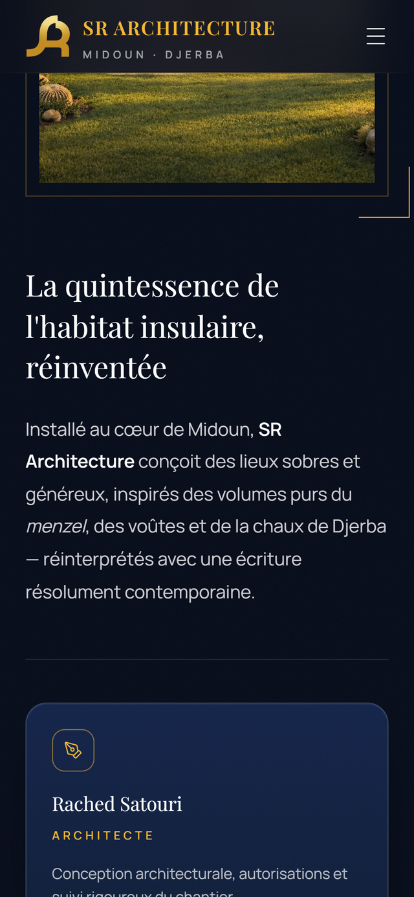

  

<h1 align="center">SR Architecture Djerba</h1>

  <b>Site vitrine d'un cabinet d'architecture, travaillé au corps côté référencement.</b>
   
  Showcase site for an architecture practice, with SEO worked in depth.

  
  

  
  
  

---

## Le projet

Une vitrine sobre pour mettre en valeur les réalisations du cabinet, avec un vrai travail de référencement derrière : structure de balises propre, sitemap soumis à la Search Console, métadonnées optimisées et suivi du positionnement sur les recherches locales à Djerba.

## Fonctionnalités

- Portfolio de projets architecturaux avec galeries photo
- Sitemap XML et robots.txt soumis à Google Search Console
- Métadonnées et données structurées optimisées pour la recherche locale
- Images optimisées et chargement différé pour un score Lighthouse élevé
- Déploiement continu sur Vercel

## Aperçu

### Ordinateur

### Mobile

  
  
  

## Fiche

| | |
|---|---|
| **Type** | Site web |
| **Contexte** | Projet client · Djerba |
| **Année** | 2025 |
| **Rôle** | Conception et développement complets (design, front-end, back-end, mise en ligne) |
| **Technologies** | React · Vercel · SEO |
| **Site** | [sr-architecture-djerba.com](https://www.sr-architecture-djerba.com) |

## Code source

> [!NOTE]
> Le code source de ce projet client est privé. Ce dépôt est une vitrine : il présente le projet, ses fonctionnalités et des captures.
> Pour en discuter ou pour un projet similaire : [portfolio](https://satouri-dev.vercel.app/fr) · [LinkedIn](https://www.linkedin.com/in/abdel-monaam-satouri-054268314).

---

  Conçu et développé par <a href="https://satouri-dev.vercel.app/fr">Satouri Développement</a> · Djerba, Tunisie
   
  © 2025 Abdelmonaam Satouri — Tous droits réservés

